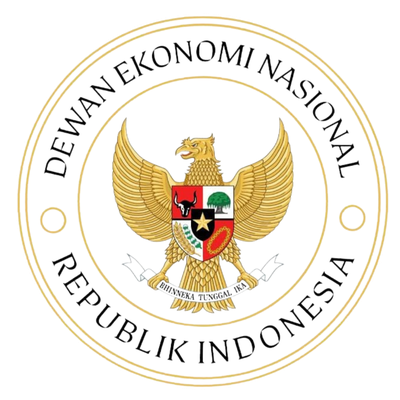

```{python}
import fig_den as den
import matplotlib.pyplot as plt
import numpy as np

den.style()
plt.rcParams.update({
    "font.family": ["Calibri", "Carlito", "DejaVu Sans"],
    "font.size": 12, "axes.labelsize": 12, "xtick.labelsize": 12,
    "ytick.labelsize": 12, "legend.fontsize": 12,
    "axes.grid": False, "axes.spines.left": False,
})


def end_label(ax, x, y, colour, fmt="{:.1f}"):
    """Value of the last point in a box of the series colour, as in DEN decks."""
    ax.annotate(fmt.format(y).replace(".", ","), (x, y), xytext=(0, 8), textcoords="offset points",
                ha="center", color="white", fontweight="bold",
                bbox=dict(boxstyle="square,pad=0.25", fc=colour, ec="none"))


quarters = [f"Tw. {q} {y}" for y in (2023, 2024, 2025) for q in ("I", "II", "III", "IV")] + ["Tw. I 2026", "Tw. II 2026"]
ratio = np.array([30.1, 29.4, 28.9, 29.6, 29.3, 29.8, 31.0, 30.4, 30.6, 30.5, 29.8, 30.0, 29.7, 30.7])
countries = ["Indonesia", "India", "Malaysia", "Thailand", "Filipina", "Tiongkok", "AS", "Jepang"]
shares = np.array([30.7, 20.0, 71.6, 35.8, 31.6, 12.2, 95.9, 103.0])
years = np.arange(2010, 2027)
tier1 = np.array([17, 13, 17, 18, 18, 31, 35, 26, 25, 27, 28, 22, 17, 18, 19, 15, 14])
tier2 = np.array([21, 23, 36, 39, 33, 63, 62, 54, 54, 54, 53, 41, 40, 39, 38, 36, 37])
```

## Slide teks: ukuran normal

- Paling banyak lima butir (enam dengan `{.normal}`), masing-masing paling banyak dua baris.
- Satu slide membawa satu pesan; judul slide menyatakan pesan itu.
- Jika isi tidak muat, pecah menjadi dua slide.
- Huruf isi Calibri 16pt di slide tanpa gambar, 14pt di slide bergambar; judul 18pt Arial tebal.

::: {.takeaway}
Kotak takeaway memuat satu pesan utama slide, paling banyak dua baris.
:::

## Judul aksi boleh dua baris: rasio *debt service* stabil, namun utang jangka pendek terhadap cadangan devisa naik {.small}

- Judul slide adalah kalimat pesan, seperti di deck DEN, paling banyak dua baris.
- Judul tiga baris otomatis mengecil ke 16pt; lebih baik dipersingkat.
- Kata *miring*, **tebal** dan `kode` di judul tetap berjarak normal.
- `.small` memuat sampai delapan butir pada 12pt.

## Persamaan

Model gravitasi yang dilinearkan:

$$
y_{ij} = \beta_0 + \beta_1 Dist_{ij} + \beta_2 gdp_i + \varepsilon_{ij}
$$

dengan $y_{ij}$ log ekspor dari negara asal $i$ ke negara tujuan $j$, $Dist_{ij}$ log jarak antara $i$ dan $j$, $gdp_i$ log PDB negara $i$, dan $\varepsilon_{ij}$ galat.

::: {.takeaway}
Setiap variabel dan parameter didefinisikan tepat di bawah persamaannya.
:::

## Dua grafik berjudul, dengan catatan dan sumber

:::: {.cols height="100%"}

::: {.plain title="Rasio ULN terhadap PDB Indonesia" unit="Persen"}
```{python}
#| fig-width: 6
#| fig-height: 4.6
fig, ax = plt.subplots(figsize=(6, 4.6))
ax.plot(range(len(ratio)), ratio, color=den.AMBER_GOLD, lw=2.5)
end_label(ax, len(ratio) - 1, ratio[-1], den.AMBER_GOLD)
ax.set_xticks(range(len(quarters)), quarters, rotation=90)
ax.set_ylim(27.5, 31.5)
fig.tight_layout()
plt.show()
```
:::

::: {.plain title="Perbandingan rasio ULN/PDB, Tw. II/2026" unit="Persen"}
```{python}
#| fig-width: 6
#| fig-height: 4.6
fig, ax = plt.subplots(figsize=(6, 4.6))
colours = [den.CLAY] + [den.AMBER_GOLD] * (len(countries) - 1)
ax.bar(countries, shares, color=colours, width=0.7)
for i, (v, c) in enumerate(zip(shares, colours)):
    end_label(ax, i, v, c)
ax.set_xticks(range(len(countries)), countries, rotation=90)
ax.set_ylim(0, 120)
fig.tight_layout()
plt.show()
```
:::

::::

::: {.note}
Angka ilustrasi; posisi per 30 Juni 2026.
:::

::: {.source}
angka ilustrasi, diolah
:::

## Grafik dan card berikon

:::: {.cols rows="2.6,1" height="100%"}

::: {.plain title="*Debt Servicing Ratio* Tier-1 dan Tier-2" unit="persen"}
```{python}
#| fig-width: 6
#| fig-height: 3.3
fig, ax = plt.subplots(figsize=(6, 3.3))
ax.bar(years - 0.2, tier1, width=0.4, color=den.AMBER_GOLD, label="DSR Tier-1")
ax.bar(years + 0.2, tier2, width=0.4, color=den.CLAY, label="DSR Tier-2")
ax.set_xticks(years, [str(y) for y in years[:-1]] + ["2Q26"], rotation=90)
ax.legend(loc="upper center", ncol=2, bbox_to_anchor=(0.5, 1.15))
fig.tight_layout()
plt.show()
```
:::

::: {.plain title="Rasio ULN terhadap PDB Indonesia" unit="persen"}
```{python}
#| fig-width: 6
#| fig-height: 3.3
fig, ax = plt.subplots(figsize=(6, 3.3))
ax.plot(range(len(ratio)), ratio, color=den.CLAY, lw=2.5)
end_label(ax, len(ratio) - 1, ratio[-1], den.CLAY)
ax.set_xticks(range(len(quarters)), quarters, rotation=90)
fig.tight_layout()
plt.show()
```
:::

::: {.card .soft title="Meningkatkan *Current Account Receipts*" icon="img/ship.png"}
- Ekspor: jangka pendek dari SDA, jangka panjang dari manufaktur.
- Bebas visa untuk menambah devisa pariwisata.
:::

::: {.card .soft title="Menjaga sentimen pasar" icon="img/coins.png"}
- Reformasi pasar modal dan transparansi kepemilikan saham.
- Arus modal yang stabil mengurangi tekanan nilai tukar.
:::

::::

::: {.source}
angka ilustrasi
:::

## Card berkepala, banner dan rekomendasi bernomor

:::: {.cols n=3 rows="1.5,0.3,1.2" height="100%"}

::: {.card title="Permintaan meningkat, tetapi rapuh" kicker="Fiskal" icon="img/bank.png"}
- Defisit APBN diproyeksikan **di atas asumsi awal**.
- Harga BBM domestik tetap di tengah harga minyak global tinggi.
:::

::: {.card title="Menahan guncangan" kicker="Bank Indonesia" icon="img/coins.png"}
- BI Rate **naik 25 bps** ke 5,75%.
- Cadangan devisa turun sejak awal 2026.
:::

::: {.card title="Menekan nilai tukar" kicker="Sektor riil" icon="img/factory.png"}
- Impor migas naik pada kuartal II.
- Pertumbuhan PMA melambat.
:::

::: {.banner .wide}
REKOMENDASI
:::

::: {.card .gold title="1  Penciptaan ruang fiskal"}
- Peningkatan *tax ratio*.
- Reformasi subsidi energi.
:::

::: {.card .gold title="2  Penegasan posisi BI"}
- Kredit diarahkan ke manufaktur berorientasi ekspor.
:::

::: {.card .gold title="3  Penguatan kualitas"}
Fokus pada produksi berorientasi ekspor dan deregulasi.
:::

::::

::: {.source}
ilustrasi susunan slide
:::

## Banner gelap, card lembut dan card berwarna

:::: {.cols rows="0.3,1,1" height="100%"}

::: {.banner .dark}
Strategi penguatan ketahanan
:::

::: {.banner .dark}
Sinergi kebijakan
:::

::: {.card .soft title="Menggeser ULN ke tenor panjang" icon="img/hourglass.png"}
Tenor lebih panjang mengurangi risiko *refinancing* dan kebutuhan valas jangka pendek.
:::

::: {.card .fill title="Bank Indonesia" icon="img/bank.png"}
- Menjaga stabilitas nilai tukar dan likuiditas valas.
- Mendorong *hedging* dan LCT.
:::

::: {.card .soft title="Mengurangi risiko valuta asing" icon="img/shield.png"}
Pengelolaan risiko nilai tukar melalui *hedging* dan kesesuaian mata uang.
:::

::: {.card .fill .rust title="Kementerian Keuangan" icon="img/coins.png"}
- Strategi pembiayaan yang *prudent*.
- Disiplin fiskal menekan *risk premium*.
:::

::::

## Tabel: sel satu baris

| Variabel | Koefisien | Galat baku | N |
|:---------|----------:|-----------:|--:|
| Log jarak | $-1{,}12$ | 0,08 | 4.210 |
| Log PDB asal | 0,94 | 0,05 | 4.210 |
| Log PDB tujuan | 0,81 | 0,06 | 4.210 |
| FTA | 0,27 | 0,11 | 4.210 |
| Perbatasan bersama | 0,43 | 0,15 | 4.210 |

::: {.source}
angka ilustrasi
:::

## Tabel: sel banyak baris

+-------------------+------------------------------+---------------+-------------------------------+
| Dimensi           | Perhitungan utama            | Metode        | Yang diukur                   |
+===================+==============================+===============+===============================+
| Konsentrasi       | HHI impor; pangsa pemasok    | EXVI + PC     | Apakah impor berasal dari     |
|                   | terbesar                     |               | sedikit negara?               |
+-------------------+------------------------------+---------------+-------------------------------+
| Ketergantungan    | Rasio impor terhadap ekspor  | EXVI          | Seberapa lemah kapasitas      |
|                   |                              |               | ekspor relatif terhadap impor?|
+-------------------+------------------------------+---------------+-------------------------------+
| Persistensi       | Rata-rata bergulir tiga      | CEPII         | Apakah sinyalnya struktural,  |
|                   | tahun                        |               | bukan guncangan satu tahun?   |
+-------------------+------------------------------+---------------+-------------------------------+

::: {.source}
angka ilustrasi
:::

## Gambar penuh dari code chunk

```{python}
fig, ax = plt.subplots(figsize=(12, 4.8))
ax.plot(years, tier2, color=den.CLAY, lw=2.5, label="DSR Tier-2")
ax.plot(years, tier1, color=den.AMBER_GOLD, lw=2.5, label="DSR Tier-1")
end_label(ax, years[-1], tier2[-1], den.CLAY, "{:.0f}")
end_label(ax, years[-1], tier1[-1], den.AMBER_GOLD, "{:.0f}")
ax.set_ylabel("Persen")
ax.legend(loc="upper left", ncol=2)
fig.tight_layout()
plt.show()
```

::: {.note}
Garis menunjukkan rasio pembayaran utang (sumbu-y) per tahun (sumbu-x).
:::

::: {.source}
angka ilustrasi
:::

## Gambar dari berkas: `.fig-half`

{.fig-half}

Slot `.fig-half` menyisakan ruang untuk teks dan kotak takeaway di slide yang sama.

::: {.takeaway}
Gunakan `.fig-full` bila gambar adalah isi slide, `.fig-half` bila gambar berbagi tempat dengan teks.
:::

## Gambar dalam kolom

:::: {.columns}

::: {.column width="40%"}
{.fig-full}
:::

::: {.column width="60%"}
- Di dalam kolom, lebar slot mengikuti lebar kolom.
- Jumlah lebar kolom paling banyak 100%.
- Paling banyak dua kolom per slide.
:::

::::

## Card: 3 × 2

:::: {.cols n=3}

::: {.card title="1 Kritikalitas"}
Fungsi esensial apa yang berhenti?
:::

::: {.card .gold title="2 Kapasitas domestik"}
Bisakah produksi ditingkatkan?
:::

::: {.card .rust title="3 Substitusi"}
Adakah pemasok lain yang kompatibel?
:::

::: {.card title="4 Penyangga"}
Berapa lama stok bertahan?
:::

::: {.card .gold title="5 Probabilitas"}
Kontrol ekspor, konflik, iklim.
:::

::: {.card .rust title="6 Validasi"}
Apakah guncangan lalu menekan output?
:::

::::

::: {.takeaway}
Warna kepala card mengelompokkan tahap, bukan hiasan.
:::

## Card: enam kolom dan satu baris

:::: {.cols n=6 rows="2,1" height="70%"}

::: {.card title="0 Material"}
Nilai dan volume dagang.
:::

::: {.card title="1 Konsentrasi"}
HHI dan Top-1.
:::

::: {.card title="2 Rasio"}
Impor terhadap ekspor.
:::

::: {.card .gold title="3 Posisi"}
RCD dan harga.
:::

::: {.card .gold title="4 Substitusi"}
HHI global.
:::

::: {.card .gold title="5 Persisten"}
Dua dari tiga tahun.
:::

::: {.card .wide}
Tahap berikutnya: kritikalitas, produksi domestik, substitusi aktual, persediaan, waktu pemulihan, dan probabilitas gangguan.
:::

::::

## Card: 4 × 2

:::: {.cols n=4}

::: {.card title="Komisi Eropa"}
Tiga kriteria kumulatif.
:::

::: {.card title="CEPII"}
Kriteria UE tiap tahun.
:::

::: {.card title="OECD"}
Konsentrasi impor dan ekspor.
:::

::: {.card title="IMF"}
Sentralitas jaringan.
:::

::: {.card .gold title="Bank of England"}
Eksposur tersembunyi.
:::

::: {.card .gold title="Australia PC"}
Uji tiga saringan.
:::

::: {.card .gold title="Jepang"}
Penetapan kualitatif.
:::

::: {.card .gold title="EXVI"}
Indeks kontinu 0 sampai 1.
:::

::::

## Gambar di dalam card

:::: {.cols}

::: {.card title="Gambar dari berkas"}

:::

::: {.card}
Gambar di dalam card mengikuti lebar dan tinggi card. Card tanpa judul berupa kotak krem berbingkai oranye.
:::

::::

## Bagian 2: Lampiran {.section-divider}

## Terima kasih {.ending-slide}
